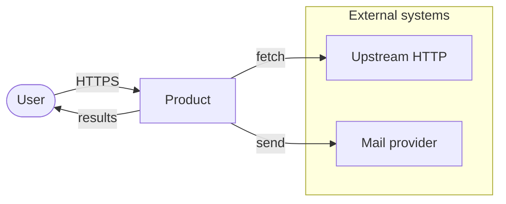
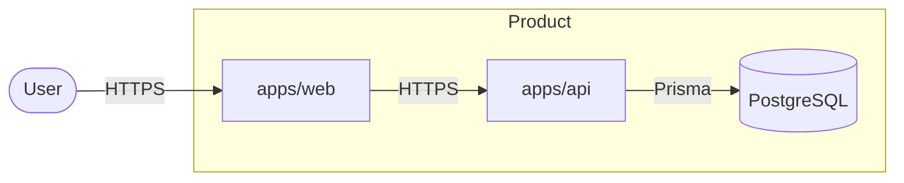

# Architecture rules

## Layers

- A controller does HTTP only: validate a DTO, call a service, shape the response.
- Business rules live in the service.
- A repository is the only code that calls Prisma.
- Domain types, domain errors, and pure functions do not import Nest HTTP, Express, or `PrismaClient`.
- A service does not import a controller. A controller does not import `PrismaService`.
- Add a layer when a second caller needs it. Do not add one because a diagram looks complete.

React:

- `apps/web/src/api/` is the only module that knows URLs and status codes.
- A feature folder holds the component, the hook, and the feature-local types.
- Do not reimplement a rule that `apps/api` already enforces. The UI may pre-validate for feedback. The API decision is the one that counts.

## When a design document is required

Write the document before code when the task:

- Adds a service, worker, or external integration.
- Changes a public API or a data contract between apps.
- Changes the database in a way that is hard to undo (new table with a data backfill, primary key change, partitioning).
- Needs two repositories, or both `apps/api` and `apps/web` with a shared contract.
- Carries a performance or security risk.

Tasks longer than a day need the `architecture` skill. Smaller forks use an ADR-lite from `.agents/agents/docs.md`.

## C4

Use two levels in design documents.

| Level | Shows | Required |
|---|---|---|
| C1 Context | The system, its users, external systems | Yes |
| C2 Container | Apps, databases, queues, object storage | Yes |
| C3 Component | Modules inside one app | Only when the inside is the decision |
| C4 Code | Classes and functions | No |

Draw Mermaid (`flowchart LR`). A box is a running process or a store. Controllers and services are not C2 boxes.

### C1



### C2



## Decisions

A non-trivial choice inside a task document:

```markdown
### Decision N: <short name>

**Chosen:** <what we will do>
**Alternatives:** <what we looked at and why we passed>
**Consequences:** <what gets better, what gets worse, what risk we accept>
```

A choice that is expensive to undo (framework, datastore, auth scheme) is a full ADR via the `docs` skill, not a paragraph in the task.

## Dynamic sources

If a feature reads a page, a paginated API, a stream, or a growing log, find out whether one snapshot is the whole dataset. A single `read` can return a window. Completeness needs an independent signal: a count, a cursor, `Content-Length`, or a total from the upstream API. Do not treat "the buffer is non-empty" as "we have everything".

## Timeouts

I/O that can hang without throwing needs a timeout on every step, including cleanup in `finally`. The first call having a timeout is not enough if `disconnect` can block forever. Name the timeout constant. Do not bury `0` or `Infinity` as a default that disables the wait the feature exists to do.

## Nest and React specifics

- A new strategy implements an existing interface in the module. Do not start a parallel class tree.
- Limit concurrency with a named cap (a pool size, a `p-limit` value). Do not spawn unbounded `Promise`s on a request.
- Retries use a single helper with exponential backoff. Settings come from config, not from a literal in the call.
- Limits (body size, page size, attempt count) are named constants and appear in the design document when the task has one.
- A new dependency needs a reason: nothing already in the repo does the job.
